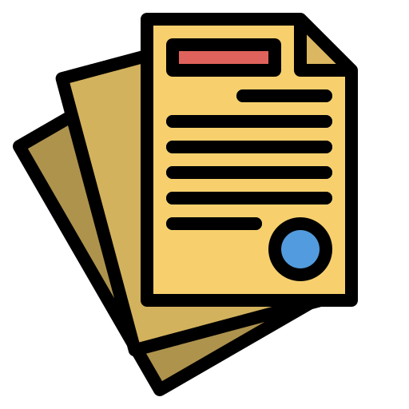

<!-- Improved compatibility of back to top link: See: https://github.com/othneildrew/Best-README-Template/pull/73 -->


<a id="readme-top"></a>
<!-- PROJECT LOGO -->
<br />
<div align="center">
  <a href="https://github.com/your_username/document-formatter">
    
  </a>

<h3 align="center">Document Formatter on Agent System</h3>

  <p align="center">
    An intelligent document processing system that uses IndexRAG to validate and format documents based on custom instructions.
    <br />
    <a href="https://github.com/N0maD/document-formatter"><strong>Explore the docs »</strong></a>
    <br />
    <br />
    ·
    <a href="https://github.com/N0maD/document-formatter/issues">Report Bug</a>
    ·
    <a href="https://github.com/N0maD/document-formatter/issues">Request Feature</a>
  </p>
</div>

<!-- TABLE OF CONTENTS -->
<details>
  <summary>Table of Contents</summary>
  <ol>
    <li>
      <a href="#about-the-project">About The Project</a>
    </li>
    <li>
      <a href="#getting-started">Getting Started</a>
      <ul>
        <li><a href="#prerequisites">Prerequisites</a></li>
        <li><a href="#installation">Installation</a></li>
      </ul>
    </li>
    <li><a href="#usage">Usage</a></li>
    <li><a href="#roadmap">Roadmap</a></li>
    <li><a href="#contributing">Contributing</a></li>
    <li><a href="#contact">Contact</a></li>
    <li><a href="#acknowledgments">Acknowledgments</a></li>
  </ol>
</details>

<!-- ABOUT THE PROJECT -->
## About The Project

This project is an intelligent agent system designed to automate the processing and validation of formal documents. Unlike simple rule-based checkers, this system utilizes a [IndexRAG](https://arxiv.org/abs/2603.16415) architecture.

It parses instruction documents (guidelines, GOST standards, etc.), constructs a Knowledge Graph to understand relationships between sections and rules, and indexes content into a Vector Database for semantic search. Users can then query the system to check if their documents meet specific requirements.

**Key Features:**
*   **IndexRAG**: using idea from this paper[].
*   **LLM Powered**: Uses a local Ollama model for generation and local MiniLM weights for embeddings.
*   **Format Support**: DOCX is a main format.
*   **Interactive UI**: Built-in FastAPI backend with a responsive HTML/JS frontend for real-time chat and processing.

<p align="right">(<a href="#readme-top">back to top</a>)</p>

### Built With

This section should list any major frameworks/libraries used to bootstrap your project.

*   FastAPI
*   Ollama
*   ChromaDB
*   LlamaIndex
*   Docker

<p align="right">(<a href="#readme-top">back to top</a>)</p>

<!-- GETTING STARTED -->
## Getting Started

To get a local copy up and running follow these simple steps.

### Local installation

Prepare the software and model weights before taking the machine offline. The
application reads the FastEmbed cache and uses an Ollama model installed on the
same machine. Old provider keys and mode environment variables have no effect.
For existing indexes created with a different embedding model, build a separate
local index from the original standards before using it for search.

**Windows, native.** Install the dependencies from `requirements-docker.txt`
in a virtual environment. Install Ollama and prepare `qwen2.5:1.5b` once
(`ollama pull qwen2.5:1.5b` during setup, or transfer the installed model).
Set `OLLAMA_NO_CLOUD=1` in the Ollama server environment before starting it.
In PowerShell, point FastEmbed to the prepared cache and launch the application:

```powershell
$env:FASTEMBED_CACHE_PATH = "D:/Projects/gost-minilm-bench/models/fastembed"
python -m uvicorn app.main:app --host 127.0.0.1 --port 8000
```

If preparing a new cache, run the following once on a machine with internet
access and FastEmbed installed, then transfer the whole cache directory:

```sh
python -c "from fastembed import TextEmbedding; TextEmbedding(model_name='sentence-transformers/paraphrase-multilingual-MiniLM-L12-v2', cache_dir='models/fastembed')"
```

**Docker Compose.** Copy `.env.example` to `.env` and set
`FASTEMBED_CACHE_PATH` to the host cache directory. Compose reuses its Ollama
volume. To seed an empty volume from an installed Windows Ollama model store:

```powershell
docker compose build
docker compose create
docker cp "${env:USERPROFILE}/.ollama/models" document-formatter-ollama:/root/.ollama/
docker compose up -d
```

Open `http://127.0.0.1:8000`. Only the web interface port is published. Both
containers share an internal network. A missing chat model produces a local
error. If embedding weights are missing, the existing hash fallback warns and
produces 256-dimensional vectors. The MiniLM model produces 384.

<p align="right">(<a href="#readme-top">back to top</a>)</p>

<!-- USAGE EXAMPLES -->
## Usage

The workflow consists of two main stages: **Indexing** and **Querying**.

1.  **Upload Files**:
    *   Select your **Document** (the work you want to check, e.g., a thesis draft).
    *   Select your **Instruction** (the rule set).
    *   Click **"Генерировать"** (Generate).

2.  **Chat with the System**:
    *   Once processing is complete, the report interface will appear.
    *   Check traceback with explanations.
    *   The system retrieves relevant rules from the graph and generates a precise answer.


<p align="right">(<a href="#readme-top">back to top</a>)</p>

<!-- ROADMAP -->
## Roadmap

- [x] Basic RAG pipeline
- [x] Knowledge Graph Integration (NetworkX)
- [x] UI for File Upload and Chat
- [x] Add support for image-based docs
- [ ] User authentication and history saving
- [ ] Export validation report to PDF
- [x] Structure Agent
- [x] Logic Agent 
- [x] auto-apply changes

<p align="right">(<a href="#readme-top">back to top</a>)</p>

<!-- CONTRIBUTING -->
## Contributing

Contributions are what make the open source community such an amazing place to learn, inspire, and create. Any contributions you make are **greatly appreciated**.

If you have a suggestion that would make this better, please fork the repo and create a pull request.

1.  Fork the Project
2.  Create your Feature Branch (`git checkout -b feature/AmazingFeature`)
3.  Commit your Changes (`git commit -m 'Add some AmazingFeature'`)
4.  Push to the Branch (`git push origin feature/AmazingFeature`)
5.  Open a Pull Request

<p align="right">(<a href="#readme-top">back to top</a>)</p>

<!-- CONTACT -->
## Contact

Artemii Korsaev - [@AK_N0maD](https://t.me/AK_N0maD) - art.kors@yandex.ru

Project Link: [Document Formatter](https://github.com/art-kors/document-formatter)

<p align="right">(<a href="#readme-top">back to top</a>)</p>

<!-- ACKNOWLEDGMENTS -->
## Acknowledgments

*   [Deep Learning School](https://dls.samcs.ru/)
*   [Artem Katsnelson](https://www.hse.ru/staff/akatsnelson/)
*   Alexander Gavrilov
*   [Zhenghua Bao](https://www.semanticscholar.org/author/Zhenghua-Bao/2405433579)
*   [Yi Shi](https://www.semanticscholar.org/author/Yidong-Shi/2204885006)

<p align="right">(<a href="#readme-top">back to top</a>)</p>

<!-- MARKDOWN LINKS & IMAGES -->
<!-- https://www.markdownguide.org/basic-syntax/#reference-style-links -->
[product-screenshot]: images/screenshot.png
[FastAPI]: https://img.shields.io/badge/FastAPI-009688?style=for-the-badge&logo=fastapi&logoColor=white
[FastAPI-url]: https://fastapi.tiangolo.com/
[Python]: https://img.shields.io/badge/Python-3776AB?style=for-the-badge&logo=python&logoColor=white
[Python-url]: https://www.python.org/
[ChromaDB]: https://img.shields.io/badge/ChromaDB-FF6F00?style=for-the-badge&logo=chromadb&logoColor=white
[ChromaDB-url]: https://www.trychroma.com/
[LlamaIndex]: https://img.shields.io/badge/LlamaIndex-00BFFF?style=for-the-badge&logo=llamaindex&logoColor=white
[LlamaIndex-url]: https://www.llamaindex.ai/
[Docker]: https://img.shields.io/badge/Docker-2496ED?style=for-the-badge&logo=docker&logoColor=white
[Docker-url]: https://www.docker.com/

## Third-party code

This repository includes [Document Formatter](https://github.com/art-kors/document-formatter) by Artemii Korsaev.
